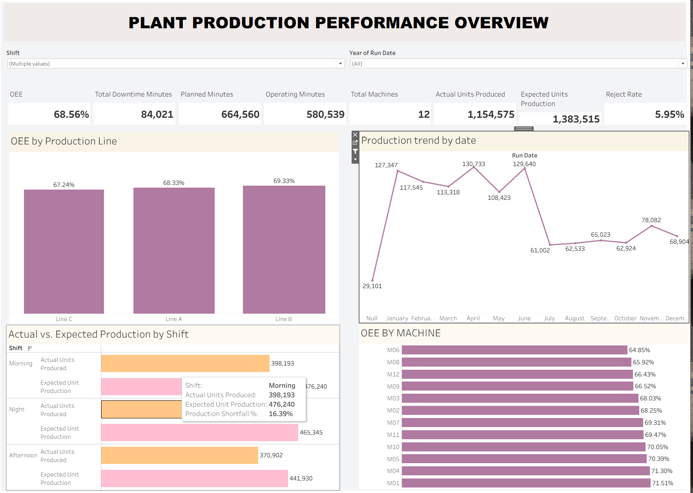
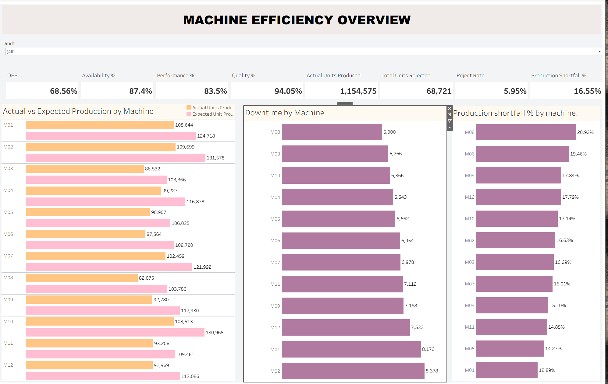
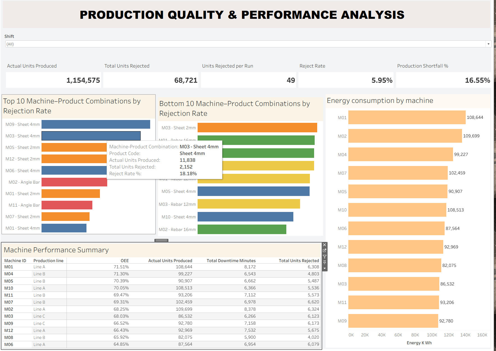

# Plant Downtime & Operational Efficiency (OEE) Analysis

## Project Overview

This project analyses the production performance and operational efficiency of Meridian Steelworks using Microsoft Excel and Tableau.

The objective was to evaluate machine efficiency, identify production shortfalls, analyse downtime, assess product quality, and compare actual production against expected production across 12 machines, three production lines, and three shifts.

The analysis involved inspecting the dataset in Excel, identifying data quality issues, developing operational KPIs, and building three interactive Tableau dashboards to uncover performance gaps and provide actionable business recommendations.

## Tableau Dashboards

# Tableau Dashboard Previews

This folder contains the three interactive dashboards developed for the Meridian Steelworks Plant Downtime and OEE Analysis project.

## 01. Machine Performance Overview

This dashboard presents overall plant performance, including OEE by production line, production trends by date, actual versus expected production by shift, and OEE by machine.

## 02. Machine Efficiency Overview

This dashboard evaluates machine efficiency using OEE, Availability, Performance, Quality, actual versus expected production, downtime by machine, and production shortfall.

## 03. Production Quality & Performance Analysis

This dashboard examines rejection rates across machine-product combinations, highlights the top and bottom 10 combinations by rejection rate, compares energy consumption by machine, and presents a machine performance summary.

## Key Performance Indicators (KPIs)

The analysis focused on the following KPIs:

- Overall Equipment Effectiveness (OEE)
- Availability %
- Performance %
- Quality %
- Total Downtime Minutes
- Planned Minutes
- Operating Minutes
- Total Machines
- Actual Units Produced
- Expected Units Production
- Production Shortfall %
- Total Units Rejected
- Reject Rate %
- Units Rejected per Run
- Energy Consumption by Machine

## Key Findings

### 1. Overall Plant Performance

- Overall OEE was 68.56%.
- Availability was 87.4%, Performance was 83.5%, and Quality was 94.05%.
- Actual production was 1,154,575 units, compared with expected production of 1,383,515 units.
- The overall production shortfall was approximately 16.55%.
- Total recorded downtime exceeded 84,000 minutes.
- Operating time was 580,539 minutes against 664,560 planned minutes.

### 2. Production Line and Shift Performance

- Line B recorded the highest OEE at 69.33%, followed by Line A at 68.33% and Line C at 67.24%.
- All three shifts produced below their expected production levels.
- The Morning shift recorded the highest actual production at 398,193 units.
- The Afternoon shift recorded the lowest actual production at 370,902 units.

### 3. Machine Efficiency

- Machine M01 recorded the highest OEE at 71.51%.
- Machine M06 recorded the lowest OEE at 64.85%.
- Machine M02 recorded the highest actual production at 109,699 units.
- Machine M08 recorded the lowest actual production at 82,075 units.
- M02 recorded the highest downtime at 8,378 minutes, while M08 had the lowest at 5,900 minutes.
- M08 recorded the highest production shortfall at 20.92%, while M01 had the lowest at 12.89%.

### 4. Product Quality

- Total rejected units amounted to 68,721, representing an overall rejection rate of 5.95%.
- The average number of rejected units per production run was approximately 49.
- M09 producing Sheet 4mm recorded the highest rejection rate at 19.98%.
- M02 producing Rebar 16mm recorded the lowest rejection rate among the combinations analysed at 3.14%.

### 5. Energy Consumption

- Machine M01 recorded the highest energy consumption at approximately 140,221 kWh.
- Machine M09 recorded the lowest energy consumption at approximately 107,328 kWh.

### 6. Data Quality Findings

- During the initial Excel inspection, 12 records were identified as completely unknown across all columns. These records contained no meaningful data and had no effect on the production analysis.
- The production trend contained a null date category associated with 29,101 units, indicating that the production dates for those records were not recorded.

## Recommendations

1. **Reduce Machine Downtime:** Investigate the causes of downtime, particularly on M02, and introduce preventive maintenance schedules to improve machine availability.

2. **Improve Production Performance:** Investigate why all machines and shifts are producing below their expected output. Review machine operating conditions, production processes, operator efficiency, and possible power interruptions.

3. **Prioritise Underperforming Machines:** Focus on M06 due to its lowest OEE and M08 due to its highest production shortfall.

4. **Improve Shift Productivity:** Review the Afternoon shift's operating conditions, staffing, and production processes to identify opportunities to improve output.

5. **Reduce Product Rejection:** Investigate the production process for M09 producing Sheet 4mm, which recorded the highest rejection rate.

6. **Monitor Energy Efficiency:** Evaluate energy consumption alongside production output, particularly for M01, which recorded the highest energy usage.

7. **Improve Data Recording:** Ensure production dates and operational information are consistently captured to improve production monitoring and reporting.

## Conclusion

The analysis revealed that Meridian Steelworks is producing significantly below its expected production capacity. With an overall OEE of 68.56% and a production shortfall of 16.55%, improving machine performance and reducing downtime should be major operational priorities.

The findings also highlight differences in machine efficiency, shift productivity, product rejection rates, and energy consumption. Addressing these issues can help improve production output, minimise operational losses, reduce waste, and optimise the use of production resources.

## Tools & Technologies

- Microsoft Excel – Data inspection and initial data quality assessment
- Tableau – KPI development, data visualisation, and interactive dashboards
- Tableau Calculated Fields – OEE, Availability, Performance, Quality, Production Shortfall, Reject Rate, and Energy Efficiency

## Project Deliverables

- Three interactive Tableau dashboards
- Operational KPI analysis
- Machine and production line performance comparison
- Production quality and rejection analysis
- Energy consumption analysis
- Key findings and business recommendations
